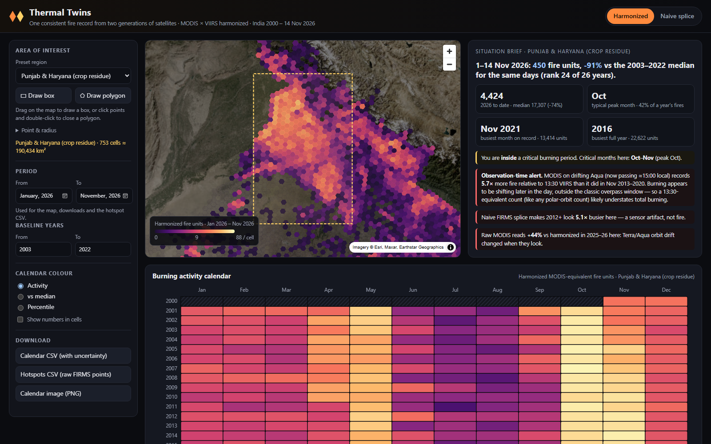

# Thermal Twins

**One consistent fire record from two generations of satellites.** Sensor-aware harmonization of MODIS and VIIRS active-fire hotspots (NASA FIRMS) into a burning activity calendar for **India and Argentina**, Nov 2000 → Nov 2026, served as a fully static web app. The record is 25 million real FIRMS detections; no synthetic or mock data is used anywhere.

*NASA Space Apps Challenge 2026: Harmonization of MODIS and VIIRS Hot Spots.*

   

**Live app:** *(add your Vercel URL here)* · **Demo deck:** [docs/Thermal_Twins_demo.pdf](docs/Thermal_Twins_demo.pdf)



---

## The problem

You cannot compare a 2005 fire count with a 2025 one by simply stacking FIRMS hotspots. We measured five artifacts that corrupt a naive MODIS + VIIRS splice. Every number below comes from our India run.

| # | Artifact | What it does to a naive record | How Thermal Twins removes it |
|---|---|---|---|
| 1 | **Resolution**: VIIRS 375 m vs MODIS 1 km pixels | One fire becomes many points. The naive national record **jumps 7.7× in 2012**. | Count unique H3 cells (r7 ≈ 5 km²) per satellite overpass |
| 2 | **Sensitivity**: VIIRS detects fires MODIS cannot | Small agricultural fires appear "new" after 2012 | **Detection-Physics Transfer (DPT)**: a learned MODIS detection curve by fire power (FRP) |
| 3 | **Constellation**: 1 → 5 satellites over 26 years | Steps at 2002 (×1.4), 2018 (×1.6), 2023 (×1.3) | One fixed virtual reference: Terra + Aqua MODIS-equivalent units |
| 4 | **Orbit drift**: Aqua 13:20 → 15:06, Terra 10:47 → 09:11 local solar time | Late MODIS counts inflated (+22% India, +66% Punjab in 2025–26) | Data-driven splice (2021) to VIIRS-derived MODIS-equivalent values |
| 5 | **Non-fire heat**: gas flares, kilns, industry | Persistent "fires" that never burn out | FIRMS static-source type plus a persistence mask (2.1 M detections removed) |

## What we built

1. **Pipeline** (`pipeline/`, Python)
   - Ingests 18 M FIRMS detections for India: MODIS C6.1 (2000–), VIIRS S-NPP (2012–), NOAA-20 (2018–) and NOAA-21 (2023–). Sources are standard processing plus near-real-time data.
   - Cleans, grids and masks them, then fits the DPT model, harmonizes, validates and exports.
2. **Web app** (`web/`, Vite + TypeScript, no server). It offers:
   - An area of interest (AOI) chosen by preset, drawn box or polygon, or point + radius.
   - A **burning activity calendar** (years × months), coloured by activity, by ratio to the median, or by percentile, with no-data months hatched.
   - A **situation brief**: this month vs the same days in previous years, year-to-date, critical months, and record month and year.
   - Season-to-date curves with a 10–90% envelope, a typical-year profile and Theil–Sen / Mann–Kendall trends.
   - A **naive-splice toggle**, so anyone can see the artifact the harmonization removes.
   - Downloads: a calendar CSV with 90% uncertainty, a **raw hotspot CSV** (all five satellites) for the AOI and period, and a calendar PNG.
   - An **observation-time alert** when a later-afternoon satellite starts seeing far more fire than 13:30 VIIRS, a sign that burning is shifting outside the overpass window.

## Method: Detection-Physics Transfer (DPT)

For each H3 r5 cell (≈ 252 km²), month and day/night:

`MODIS units ≈ f_region · Σ_b w_b · N_VIIRS,b`

- **N_VIIRS,b** = VIIRS fire units in FRP bin *b* (<1, 1–2, 2–4 … >64 MW).
- **w_b ≥ 0** = learned MODIS detection probability for that bin, fitted by non-negative Poisson maximum likelihood.
- **f_region** = empirical-Bayes regional factor (local burn timing and cloud regime).
- The model is trained on 2012–2016, when Aqua and S-NPP shared the 13:30 orbit, and tested on 2017–2020.
- It is linear, so any AOI is an exact sum of cells.
- Uncertainty is a 5–95% bootstrap over training years plus Bernoulli/Poisson noise, reported as 90% intervals.
- After 2 Nov 2026, NOAA-20 replaces S-NPP, cross-calibrated over 2019–2025 (scale 0.97 day, 0.95 night).

**What it learned:**
- MODIS records about 1% of VIIRS fire units below 2 MW, about 37% at 16–32 MW, about 74% at 32–64 MW, and about all of them above 64 MW.
- An independent overpass-level collocation gives the same monotone curve.

## Validation (held-out years 2017–2020, never seen in training)

| Method | Aqua pseudo-R² | Aqua WAPE | Terra pseudo-R² | Terra WAPE |
|---|---|---|---|---|
| Raw FIRMS points × constant | 0.53 | 31.9% | −0.17 | 31.4% |
| Equal-area cells × constant | 0.50 | 29.2% | −0.19 | 30.3% |
| Cells + day/night factors | 0.52 | 22.5% | −0.18 | 29.6% |
| **Thermal Twins DPT** | **0.79** | **21.8%** | **0.51** | **18.2%** |

- Pseudo-R² is the share of cell-month variability explained (Poisson deviance). WAPE is the national monthly absolute error divided by the total.
- After calibration, held-out years sit at 0.98–1.10 (actual ÷ predicted) nationally.
- Clipping the API data to the country footprint drops 1.26% of genuine detections, measured on 2025 as a holdout.

## Results by region (held-out 2017–2020 unless noted)

| | India | Argentina |
|---|---|---|
| FIRMS detections harmonized | 18.0 M | 7.05 M |
| Aqua, cell-month pseudo-R²: DPT vs equal-area cells | **0.79** vs 0.50 | **0.69** vs 0.05 |
| Terra, cell-month pseudo-R²: DPT vs equal-area cells | **0.51** vs −0.19 | **0.53** vs −0.57 |
| National monthly error (WAPE), Aqua: DPT vs best simple baseline | **21.8%** vs 22.5% | 15.7% vs **12.3%** (baseline better) |
| National monthly error (WAPE), Terra: DPT vs best simple baseline | **18.2%** vs 29.6% | **14.3%** vs 23.8% |
| MODIS 50% detection power (collocated, day / night) | ~70 / 30 MW¹ | 25 / 17 MW |
| Aqua overpass drift (mean daytime local solar time) | 13:20 → 15:06 | 13:54 → 15:47 |
| Data-driven splice to VIIRS-derived values | 2021 | 2022 |

¹ India's day curve has no clear plateau, so the logistic fit hits its upper bound; read it as "above ~30 MW".

## Uncertainty you can check

Every VIIRS-derived month carries a 90% band. Its variance has three parts: detection noise, overdispersion and proportional model error. The bands are calibrated by **split-conformal prediction** on out-of-sample years 2017–2018, then tested on held-out 2019–2020 against the MODIS counts actually observed.

| Area size | India: coverage · median half-width | Argentina: coverage · median half-width |
|---|---|---|
| 1 cell (253 km²) | 89.5% · ±68% | 90.5% · ±353% (too wide to be useful) |
| ~1,800 km² | 88.6% · ±63% | 92.3% · ±129% |
| ~12,400 km² | 87.2% · ±74% | 91.7% · ±56% |
| ~87,000 km² | 87.4% · ±86% | 91.1% · ±48% |
| National | 91.7% · ±58% | **75.0%** · ±21% (24 test months; fails, see below) |

Two rules in the app follow from this table:
- Where a scale failed its held-out check, the app uses the next smaller scale that passed, which gives wider and honest bands.
- Where the typical band is wider than ±100%, it shows a "small area" warning.

## Known limitations

- **Monthly MODIS-level counts are noisy.** Even with a correct model, a single month in a small area can only be reconstructed within roughly ±60–130%. Seasonal patterns, rankings and anomalies are robust; individual small-area months are not.
- **Argentina, national scale:** the 90% band covered only 75% of the held-out national months. 2019–2020 were exceptional fire years (Paraná Delta, Córdoba), and 24 months is too few to calibrate a national band. Also, a simple day/night-scaled cell count is slightly better for the national Argentine total (12.3% vs 15.7%). The DPT's advantage is local, at the cell and regional scale.
- **Polar orbiters only see two moments a day.** If burning moves outside the overpass windows, every polar-orbit record understates it, harmonized or not. The app's observation-time alert flags this but cannot fill it in. Geostationary data (GOES, Himawari, GK-2A, INSAT-3D) is the next step.
- **No morning VIIRS.** After Terra ends, the morning share is modelled from the 2003–2019 Terra/Aqua relationship.
- **Pre-July 2002:** the Aqua share is gap-filled from Terra with a region × calendar-month ratio.
- **Country clipping:** API rows are clipped to each country's FIRMS footprint, which drops about 1.3% of genuine detections (measured on 2025).

## A finding the harmonization exposed (Punjab & Haryana, 1–14 Nov)

| Year | VIIRS NOAA-20 units (13:30) | Aqua MODIS units (drifting later) | Aqua ÷ VIIRS |
|---|---|---|---|
| 2021 | 36,765 | 9,970 | 0.27 |
| 2023 | 14,700 | 4,113 | 0.28 |
| 2025 | 3,013 | 2,194 | 0.73 |
| 2026 | 2,619 | 3,963 | **1.51** |

- Fire visible at the classic early-afternoon overpass fell about 93% since 2021.
- Aqua now passes at about 15:06, and it sees **5.6× more fire relative to VIIRS** than before.
- This is consistent with reports that crop-residue burning has moved later in the day (ISRO SAC 2025).
- Burning has not vanished. Polar-orbit counts, raw or harmonized, increasingly understate it, and the app flags this automatically.

## Repository layout

```
pipeline/            Python data pipeline (one module per stage; python -m pipeline.run runs all)
  bulk.py            FIRMS country yearly CSVs (no key, no quota)
  fetch.py           FIRMS Area API top-up (current year, NOAA-21), resumable and quota-aware
  clean.py · grid.py normalize, H3 cells per overpass, static-source mask, country clip
  dpt.py             Detection-Physics Transfer: fit + held-out validation
  harmonize.py       MODIS-equivalent series, orbit-drift diagnostic, data-driven splice
  coverage.py        split-conformal calibration and held-out test of the 90% bands
  export.py          compact static bundle for the web app (4.7 MB gz)
  hotspots.py        raw-hotspot packs for CSV download
  figures.py         slide figures
web/                 static web app (Vite + TypeScript, MapLibre, ECharts, h3-js)
tests/e2e.py         real-browser end-to-end checks (Playwright + Edge)
tests/record_demo.py captioned 30 s screen recording of the app
docs/                demo deck, figures, screenshots
data/processed/      model parameters, drift table, national series (small, versioned)
```

## Run the app locally

```bash
cd web
npm ci
npm run dev        # http://localhost:5173
```

## Deploy (Vercel)

Import this repository in Vercel and keep the defaults; `vercel.json` already sets the install, build and output paths.
- **Branch:** the app lives on `Nitant`. Either deploy that branch as a preview, or set Production Branch to `Nitant` under Project Settings → Git.
- **Raw-hotspot packs** (~120 MB) are not bundled into the deployment. The app streams them from this public repository; set `VITE_HOTSPOT_BASE` to serve them from somewhere else.

## Rebuild the data

```bash
python -m venv .venv && .venv/Scripts/pip install -r requirements.txt
cp .env.example .env                       # free FIRMS MAP_KEY (only needed for the current-year top-up)
.venv/Scripts/python -m pipeline.run --aoi india
.venv/Scripts/python -m pipeline.run --aoi argentina
```

Stages can be run on their own (`python -m pipeline.<stage> --aoi india`) or resumed with `--from <stage>`.

## Data and references

- **NASA FIRMS** (Fire Information for Resource Management System): MODIS Collection 6.1 active fire (Terra, Aqua) and VIIRS 375 m active fire (Suomi NPP, NOAA-20, NOAA-21), standard processing and near-real-time. https://firms.modaps.eosdis.nasa.gov/
- Giglio, L., Schroeder, W., Justice, C. O. (2016). The Collection 6 MODIS active fire detection algorithm and fire products. *Remote Sensing of Environment*.
- Schroeder, W., Oliva, P., Giglio, L., Csiszar, I. (2014). The New VIIRS 375 m active fire detection data product. *Remote Sensing of Environment*.
- Li, F. et al. (2018). Comparison of fire radiative power estimates from VIIRS and MODIS observations. *JGR Atmospheres*. https://doi.org/10.1029/2017JD027823
- Sofiev, M., Kouznetsov, R. (2026). Detection limits of MODIS and VIIRS fire products (EGUsphere preprint).
- NASA Earthdata: *Transitioning from Suomi NPP VIIRS: What FIRMS users need to know*; LAADS *MODIS to VIIRS transition*; Terra and Aqua mission status pages (orbit drift).
- Uber H3 hierarchical hexagonal grid; MapLibre GL; ECharts. Basemap imagery © Esri, Maxar, Earthstar Geographics.

## Use of SI tools

An AI coding assistant was used to speed up drafting of data-pipeline code and documentation. The team reviewed and tested all of it and is responsible for its content.
